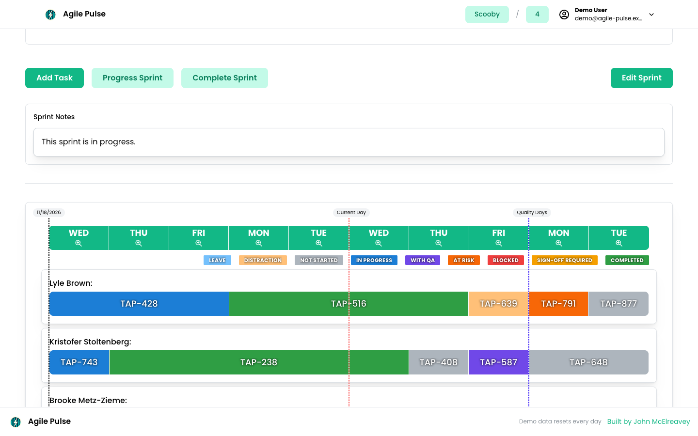
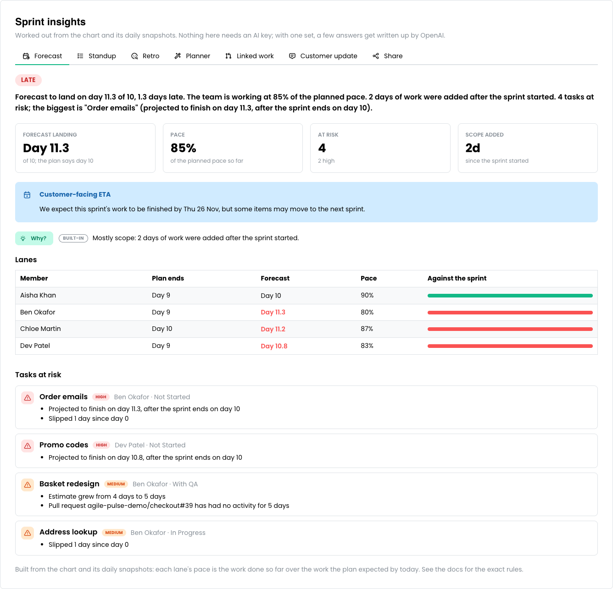
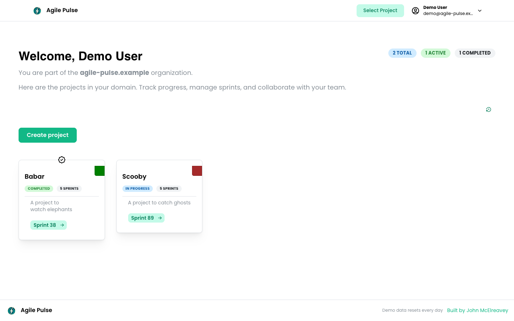
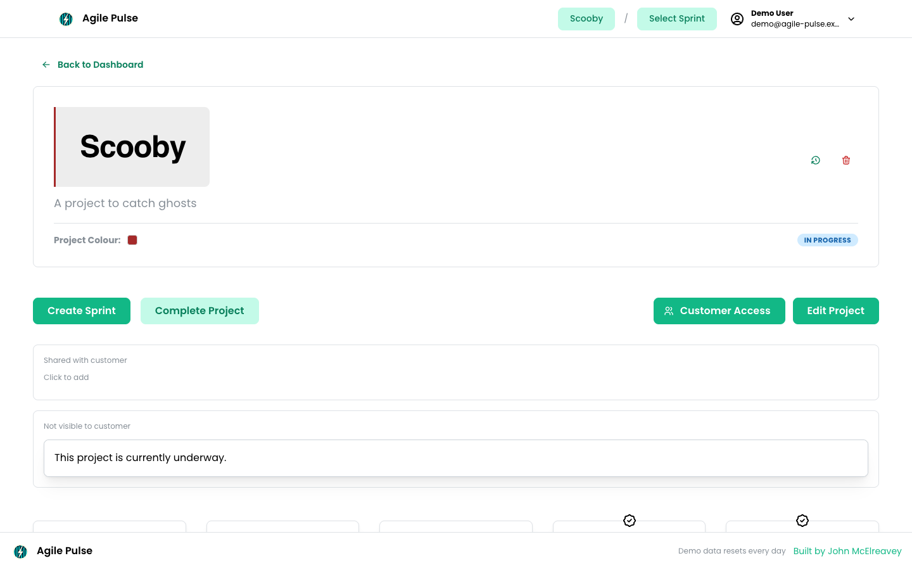

# Agile Pulse

Sprint planning you can see at a glance. Agile Pulse lays each sprint out as a chart of people against days, so you can tell in a few seconds who is on what, what is at risk and whether the sprint will land.

**[Try the live demo](https://agile-pulse-demo.j-mcelreavey.workers.dev)**: no account needed, press "Explore the demo". The demo workspace is shared and resets every day.



## Features

- **Sprint chart.** Tasks are blocks on each member's lane across the sprint's working days, coloured by state (not started, in progress, with QA, at risk, done). Drag tasks to reorder them or move them between people, zoom into days, and see overruns past the sprint end.
- **Current day and snapshots.** Progress the current-day marker and Agile Pulse stores a snapshot of the chart, so you can step back through how the sprint actually went.
- **Deadlines.** Mark quality days, releases and other milestones on the timeline.
- **Projects and sprints.** Group sprints under projects, carry unfinished tasks into the next sprint, and archive and restore anything.
- **Customer portal.** Invite customers to follow progress on their projects, read published updates and comment, without seeing internal detail.
- **Changelogs.** Turn completed tasks into release notes, edit them in a rich text editor, share them with customers by email or save them as PDF. Uses OpenAI when a key is set and a built-in writer otherwise.
- **Jira.** Optionally sign in with Atlassian and pull sprints and issues from Jira.

### Sprint insights

Agile Pulse was built before AI tools were everywhere. The newer features keep that spirit: each one works out its answer with plain, tested code from the chart and its daily snapshots, and AI only writes it up when an OpenAI key is set. Everything below works in the keyless demo. [Why it's built this way](docs/Overview.md).

- **Forecast.** When the sprint will land, each person's pace and which tasks are at risk, with reasons (behind plan, slipped, QA bounces, blocked time, stale PRs). Optional one-line AI "why". [More](docs/Forecast.md)
- **GitHub and Jira sync.** Link tasks to pull requests and issues. Signed webhooks move tasks along: a merged PR completes its task, and a PR that goes quiet marks it at risk. [More](docs/Integrations.md)
- **Standup digest.** What moved since yesterday, today's focus per person and blockers, in the app or sent to Slack and email on weekday mornings. [More](docs/Standup.md)
- **Sprint planner.** Paste a backlog and get it laid out by capacity, leave and each person's past completion rate, then adjust by dragging. AI only estimates unsized items. [More](docs/Planner.md)
- **Retro prompts.** Discussion points drawn from the sprint's replay, each with the evidence and an open question. [More](docs/Retro.md)
- **MCP endpoint.** Connect Claude, Cursor or ChatGPT with a personal token to read forecasts and standups and move tasks. [More](docs/MCP.md)
- **Customer updates.** A drafted weekly update and a forecast-based ETA with a confidence level, shown in the customer portal. [More](docs/CustomerPortal.md)
- **Sharing.** Public read-only sprint links and an iCal feed of deadlines, sprint dates and the forecast. [More](docs/Sharing.md)
- **Keyboard and dark mode.** Move tasks with the keyboard, and a theme that follows your system. [More](docs/Accessibility.md)



| Projects | Project overview |
| --- | --- |
|  |  |

## Run it locally

Requirements: Node.js 22 or newer.

```bash
git clone https://github.com/jmcelreavey/agile-pulse.git
cd agile-pulse
npm install
npm run demo:sql                                              # build the demo data
npx wrangler d1 execute agile-pulse-demo --local --file=.demo/demo.sql
npm run dev                                                   # http://localhost:3033
```

No keys are needed. `npm run dev` uses a local D1 database through Wrangler, and you sign in with the demo account. To switch on Google or Jira sign-in, AI, email, webhooks or Slack digests, copy `.env.example` to `.env` and fill in the values you need. [docs/Configuration.md](docs/Configuration.md) lists every variable, including the newer ones (`GITHUB_WEBHOOK_SECRET`, `JIRA_WEBHOOK_SECRET`, `SLACK_WEBHOOK_URL`, `DIGEST_EMAIL_TO`, `STALE_PR_DAYS`).

```bash
npm run check     # typecheck, lint and unit tests
npm run build     # production build
```

## Deploy to Cloudflare

Agile Pulse runs on Cloudflare Workers with a D1 database, which fits in Cloudflare's free tier for a demo.

```bash
npx wrangler d1 create agile-pulse-demo          # put the id in wrangler.jsonc
openssl rand -base64 32 | npx wrangler secret put AUTH_SECRET
npm run cf:deploy
npm run cf:db:reset                              # load the demo data into D1
```

Set `SITE_URL` in `wrangler.jsonc` to your Worker's URL. Optional integrations are set with `npx wrangler secret put <NAME>`, using the names in `.env.example`.

## How it's built

Next.js 16, React 19, tRPC 11, Prisma 7 on Cloudflare D1, Auth.js, Mantine 9 and Tiptap, deployed with OpenNext for Cloudflare. See [docs/Architecture.md](docs/Architecture.md) for the layout, data access, soft delete and demo reset, and the other files in [docs](docs) for each feature. The same docs are published in the app at [/docs](https://agile-pulse-demo.j-mcelreavey.workers.dev/docs); run `npm run docs:build` after editing them.

## Licence

[MIT](LICENSE) © John McElreavey
